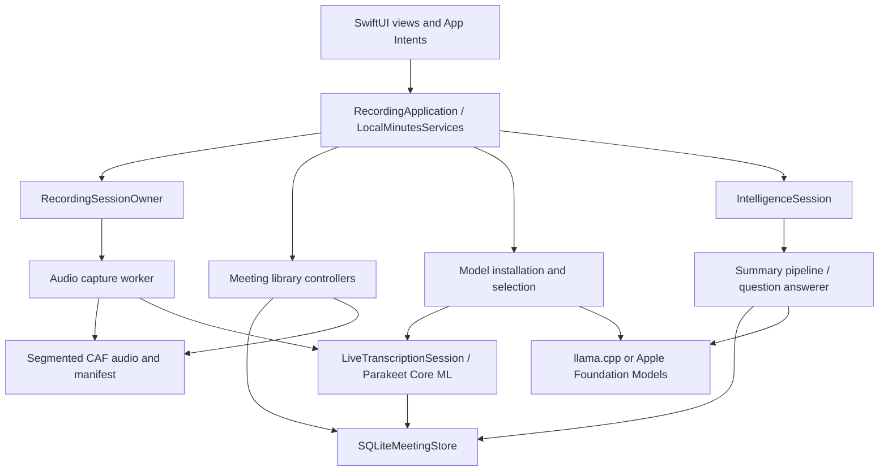
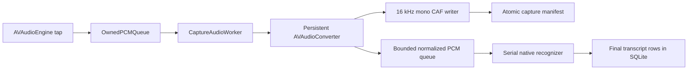

# LocalMinutes architecture

LocalMinutes is a SwiftUI iPhone application with local recording, speech recognition, meeting storage, and post-recording intelligence. Its central constraint is ownership: asynchronous work must retain the exact recording session, meeting, model installation, and resource lease that authorized it. A late callback must not mutate a replacement session or another selected meeting.

Build and test instructions are in [README.md](./README.md). This document describes the current implementation rather than a roadmap or historical milestone record.

## Structure and composition

[LocalMinutesApp](./App/LocalMinutesApp.swift) presents an application-lived [RecordingApplication](./App/RecordingApplication.swift). [LocalMinutesServices](./App/LocalMinutesServices.swift) composes persistence, model installation and selection, transcription, meeting operations, intelligence, and diagnostics. Views observe these controllers; they do not own microphone or native-model lifetimes.



[Package.swift](./Package.swift) exposes nine Swift libraries for macOS testing. [project.yml](./project.yml) compiles the same directories directly into the iOS app; conditional `SWIFT_PACKAGE` imports support both arrangements.

| Directory | Responsibility |
| --- | --- |
| [App](./App) | Composition, SwiftUI screens, intents, iOS signals, playback ownership, privacy cover, and system metrics |
| [Core](./Core) | Recording state machine, bounded audio queues, resource admission, filesystem policy, archive format, and metrics contracts |
| [Recording](./Recording) | Microphone/audio-session boundaries, conversion, CAF writing, recording owner, and intent routing |
| [Models](./Models) | Immutable manifests, compatibility assessment, transfers, imports, installation leases, and selections |
| [Persistence](./Persistence) | Actor-owned SQLite connection, schema migrations, notes, transcript rows, generated documents, model pins, and checkpoints |
| [MeetingLibrary](./MeetingLibrary) | History, selection, edits, playback mapping, exports, startup reconciliation, recovery, deletion, and library replacement |
| [Transcription](./Transcription) | Parakeet TDT Core ML adapter, live transcription, and checkpointed transcription replay |
| [Summaries](./Summaries) | Native local-language runtime, JSON schemas, token planning, evidence validation, summary maps, and deterministic merge |
| [QuestionAnswering](./QuestionAnswering) | Selected-meeting evidence retrieval, bounded prompts, and exact-quote answers |
| [Intelligence](./Intelligence) | Inference lifecycle, cancellation, commit admission, summary resume, and Apple Foundation Models adapter |
| [Shared](./Shared), [LiveActivityExtension](./LiveActivityExtension) | Recording activity state, scoped Stop control, and WidgetKit presentation |

The extension presents recording state; it does not capture audio or load models. The app and extension share activity attributes and control definitions.

## Ownership and concurrency

UI-facing controllers and application composition run on the main actor. SQLite and model installation each have actor isolation. Parakeet recognition and local-language generation serialize their work behind their adapters. The microphone callback communicates through bounded queues rather than starting asynchronous tasks.

[HeavyModelAdmission](./Core/HeavyModelAdmission.swift) permits one heavy use at a time: live ASR, summary, question answering, or library maintenance. Its lifecycle is `idle → admitted → draining → idle`. A cleanup failure leaves it `cleanupBlocked`; a later retry completes the outstanding cleanup before allowing another use. Cancellation alone does not release the resource.

Meeting usage leases additionally protect recordings and maintenance from deletion races. Playback has its own [ownership controller](./App/PlaybackOwnershipController.swift) because it shares the OS audio session with capture. Starting recording stops playback and drains conflicting replay/intelligence work before acquiring recording resources.

Session UUIDs, epochs, and exact lease tokens distinguish a current operation from stale callbacks. Manual-note reservations similarly capture a meeting and edit revision before debounce; a later selection change cannot retarget the edit.

## Recording and transcription

### Start and readiness

[RecordingCoordinator](./Core/RecordingCoordinator.swift) is the recording state machine. Its phases are idle, preparing, recording, stopping, completed, interrupted, recoverable failure, and failure. [RecordingSessionOwner](./Recording/RecordingSessionOwner.swift) owns the resources needed to implement those transitions.

A start joins startup reconciliation, reserves shared resources, checks model and storage readiness, loads the selected recognizer, creates a meeting with its exact speech-model pin, and prepares the Live Activity and microphone. The app requires at least 1 GB free storage at preparation. It does not declare recording active until all three readiness facts hold:

1. The audio session is active.
2. The capture pipeline has accepted its first buffer.
3. The Live Activity is active.

Missing or invalid speech models reject startup. There is no silent fallback to recording without transcription.

### Audio path



[IOSCaptureHardware](./Recording/IOSCaptureHardware.swift) uses an audio session in record/measurement mode and inspects the actual input format. The requested 2,048-frame tap size is a hint, not a promise about callback size. [CaptureCallbackAdmission](./Core/CaptureCallbackAdmission.swift) and [OwnedPCMQueue](./Core/OwnedPCMQueue.swift) bound callback ownership. The real-time callback does not perform file I/O, inference, or task creation. Overlap, invalid input, or lost capacity is treated as a capture failure rather than hidden audio loss.

[CaptureAudioWorker](./Recording/CaptureAudioWorker.swift) drains source PCM on a serial worker. A persistent converter produces 16 kHz mono Float32 samples. Converted audio is written before it is offered to the separate ASR queue, which has 128 slots of at most 3,200 frames each.

[SegmentCAFWriter](./Recording/SegmentCAFWriter.swift) stores 16-bit mono PCM in CAF segments, normally up to 960,000 frames / 60 seconds each. A segment is closed and synchronized before an atomic manifest update publishes its relative path and sample range. The open tail is not treated as durable after a crash. Sample positions form one recording-wide timeline.

[LiveTranscriptionSession](./Transcription/LiveTranscriptionSession.swift) consumes normalized PCM away from the capture callback. Parakeet publishes finalized windows. These segments are written to SQLite before being presented as saved transcript. Bounded PCM queues do not imply constant memory for an entire meeting: accumulated transcript/UI data can grow with its duration.

### Stop and interruptions

Stop closes callback admission, waits for admitted callbacks, drains conversion and CAF writing, finalizes transcription, unloads the native model, releases its installation lease, and ends the Live Activity. Completion is acknowledged only after the owned cleanup succeeds. Failed cleanup retains admission so another operation cannot reuse resources prematurely.

[IOSRecordingSignalMonitor](./App/IOSRecordingSignalMonitor.swift) scopes interruptions, route changes, media-service resets, thermal conditions, and storage signals to the current epoch. A late signal cannot stop a replacement session. Interruptions do not silently restart the microphone.

### Speech recognition

[CoreMLParakeetRecognizer](./Transcription/CoreMLParakeetRecognizer.swift) is the speech adapter for live recording and replay. It uses FluidAudio's Swift TDT decoder with compiled Core ML models, 16 kHz mono PCM, and disjoint five-second windows. It publishes each window's finalized text during capture and flushes the remaining audio on stop. Segment times retain the source sample range; word alignment and speaker diarization are not provided.

[GentleSpeechDenoiser](./Transcription/GentleSpeechDenoiser.swift) processes a copy of unpadded PCM on the adapter's owned CPU worker, for both live and recovered audio. It uses 32 ms square-root-Hann frames, 50% overlap, and rolling spectral minima over about 1.5 seconds to estimate steady noise without assuming that the meeting starts in silence. Frequency and time smoothing limit abrupt changes; every frequency retains at least 70.8% amplitude (a maximum 3 dB reduction). There is no speech gate, discarded audio, gain boost, or added source-timeline delay. A new transcription epoch resets the noise profile, including when replay resumes; already committed transcript rows are not rewritten. Original CAF recordings stay intact. Setup failure or a filtered window that would clip falls back to original PCM. An adapter-level `.off` policy supports comparisons. Synthetic signal tests check quiet components, tails, onset alignment, cancellation, reset, and bounded output; actual-model tests compare the same real speech at -24 dB with/without 15 dB-SNR noise under both policies. These tests do not establish distant-speaker, whisper, reverberant-room, or physical-iPhone performance; the new Swift/native cases still require macOS execution.

[SpeechRecognition](./Transcription/SpeechRecognition.swift) defines errors, lifecycle phases, and finalized segment updates. [ParakeetModelAdapter](./Transcription/ParakeetModelAdapter.swift) selects the decoder using the manifest's explicit contract and validates loaded Core ML input/output descriptions and decoder state shapes.

| Decoder contract | Core ML pack support |
| --- | --- |
| `parakeet-tdt-v2` | int8 encoder; built-in pinned v2 conversion in [ParakeetCoreMLModel](./Models/ParakeetCoreMLModel.swift) or a valid versioned pack |
| `parakeet-tdt-v3` | int8, int8-v2, or int4 encoder; bundled [v3 descriptor](./Resources/ModelPacks/Parakeet-v3.json) uses int8 |

[ParakeetModelPack](./Models/ParakeetModelPack.swift) validates the decoder contract, precision, component paths, immutable revision, sizes, digests, and attribution. It requires the encoder, decoder, preprocessor, matching joint-decision model, and vocabulary. Other decoder contracts are rejected until the app has a matching adapter; a model name alone cannot enable them.

CPU-only is the production default. The adapter also exposes an explicit CPU-and-Neural-Engine policy; neither policy selects GPU inference. Native tests exercise both model versions on hosted macOS. Live speed, thermal endurance, and locked-screen operation on an iPhone remain device properties.

## Model lifecycle

[ModelManifest](./Models/ModelManifest.swift) binds a model identity to an immutable revision, exact file sizes and SHA-256 hashes, license notice, runtime identity, and semantic file roles. Compatibility, resource estimates, byte verification, and successful native load are separate checks.

[ModelCatalog](./Models/ModelCatalog.swift) exposes two speech cards and six summary family cards. [SummaryCatalog.json](./Models/Resources/SummaryCatalog.json) contains twelve summary variants with immutable publisher revisions, sizes, SHA-256 digests, licences, and adapter profiles. The UI has no repository lookup or arbitrary model import. Runtime contracts validate the selected model again before inference; a file extension does not establish compatibility.

[ModelInstallationManager](./Models/ModelInstallationManager.swift) follows this lifecycle:

1. Download or copy imported files into owned staging.
2. Verify all expected paths, sizes, digests, and required roles.
3. Publish an immutable `Models/<modelID>/<revision>/<installationUUID>/` directory and manifest.
4. Atomically update that model's `current.json` pointer.
5. Reverify bytes when acquiring a usage lease. Keep leased older installations alive across replacement; reject removal while in use.

The model browser matches legacy installations by exact source revision and artifact bytes, preserving their original metadata and installation identity. Downloading does not equip a variant. Remove deletes installed bytes and retained download checkpoints; removing the equipped variant writes an explicit unequipped selection. Active inference leases prevent deleting models still in use.

[ModelFilesImporter](./Models/ModelFilesImporter.swift) remains an internal installation/test boundary; it is not exposed in model settings. Core ML imports require the complete supported compiled-model tree. Source files are not used as mutable inference storage.

[HTTPSModelTransport](./Models/HTTPSModelTransport.swift) uses HTTPS with an explicit distribution-host allowlist and no account credentials or cookies. [ResumableModelDownload](./Models/ResumableModelDownload.swift) keeps partial bytes and a checkpoint under a separate download root. Resume binds the exact artifact pin, strong ETag, and partial digest; it validates `206` ranges and restarts on a full `200` response.

[ModelSelectionStore](./Models/ModelSelectionStore.swift) persists an exact verified installation and runtime profile per purpose. An explicit absent, invalid, removed, or incompatible selection does not silently fall back. Without a selection record, the app checks the built-in Parakeet v2 and Phi-3 model IDs. Each new meeting stores the exact speech selection it used, including installation UUID.

Apple Foundation Models is a distinct system provider. It has no app-downloaded weights or weight hash and is usable only when the OS reports it available. Its provenance is tied to the system/runtime version.

## Persistence and filesystem layout

The application root is `Application Support/LocalMinutes`. The initial library uses that root directly. After restore, `activeLibrary.json` can select a generation under `LibraryGenerations/<UUID>`.

```text
LocalMinutes/
  activeLibrary.json                   # Present after switching library generations
  meetings.sqlite                      # Initial library database
  Meetings/<meeting UUID>/
    segment-000000.caf
    capture-manifest.json
    recovery-report.json               # When recovery has run
    transcription-replay.json          # When replay has checkpointed
    RecoveryQuarantine/
  Meetings/.pending-deletions/<UUID>/
  SummaryCheckpoints/<meeting UUID>.json
  LibraryGenerations/<UUID>/            # Replacement database, meetings, checkpoints
  Models/
  ModelSelections/
  DownloadResume/
  ModelImports/
  Diagnostics/
  Exports/
```

The model, selection, download, diagnostic, and export roots belong to the application rather than to a replaceable library generation.

[PersistentFilePolicy](./Core/PersistentFilePolicy.swift) applies private directory/file permissions (`0700` / `0600`), excludes owned data from system backup, and applies iOS `completeUntilFirstUserAuthentication` protection. Data is unavailable before the first unlock after boot, but can support locked recording afterward. This is OS file protection, not additional application-level encryption. Path operations reject unsafe links and validate ownership; atomic writes synchronize temporary files before replacement.

[SQLiteMeetingStore](./Persistence/SQLiteMeetingStore.swift) owns its native connection through an actor. It enables foreign keys, full synchronization, a bounded busy timeout, and transactional writes. The code does not explicitly enable WAL as its normal journal mode; privacy handling and tests also cover sidecars when SQLite creates them.

[MeetingSQLiteConnection](./Persistence/MeetingSQLiteConnection.swift) migrates incrementally to schema version 5 and rejects future schema versions before changing them:

| Version | Added data |
| --- | --- |
| 1 | `meetings` and ordered `transcript_segments`, including capture state, sample ranges, and model revision |
| 2 | `manual_notes` with optimistic edit revision and modification time |
| 3 | External-content FTS5 transcript index and synchronization triggers |
| 4 | `generated_documents`, immutable original JSON, separately edited text, provenance, and edit revision |
| 5 | `meeting_speech_model_pins` containing exact model-selection JSON |

Final transcript writes are idempotent for matching IDs/content and reject conflicting sequences or cross-meeting data. Note and generated-text edits use revisions to prevent delayed saves from overwriting newer edits. The original generated JSON is capped at 1 MB and remains separate from user edits and source transcript.

History uses stable cursor pagination; transcript search and evidence retrieval have bounded result sets. Search is scoped to the selected meeting. This is SQLite/FTS retrieval, not a vector database.

## Recovery, deletion, and backup

[LibraryStartupCoordinator](./MeetingLibrary/LibraryStartupCoordinator.swift) replays pending deletion work, pages through unfinished meetings, and reconciles recoverable state before opening recording admission. Failure remains visible instead of assuming an empty healthy library.

[MeetingRecoveryCoordinator](./MeetingLibrary/MeetingRecoveryCoordinator.swift) verifies the capture manifest and decodes closed CAF files. Missing or corrupt audio becomes explicit timeline gaps. Uncommitted or corrupt tails are quarantined; their positions are not guessed. Its durable journal allows retry after metadata failure.

[MeetingTranscriptionReplayCoordinator](./Transcription/MeetingTranscriptionReplayCoordinator.swift) replays recovered audio using the meeting's captured Parakeet model pin. A missing, invalid, or unsupported pin refuses replay without altering the original audio or transcript. A checkpoint binds the audio/recovery manifests, committed transcript rows, and model pin. Resume appends remaining finalized rows without duplicate output. Reinstalling identical weights under another installation UUID does not satisfy the original pin. Checkpoint hashes detect inconsistency; they are not cryptographic authentication against an attacker controlling the library.

[MeetingDeletionCoordinator](./MeetingLibrary/MeetingDeletionCoordinator.swift) checks usage, records a durable request, quarantines owned audio, deletes metadata with cascading rows, and completes filesystem cleanup. Startup can finish an interrupted deletion. Deleting a current meeting does not erase copies already exported or retained in previous library generations.

[MeetingArchive](./Core/MeetingArchive.swift) exports a `.localminutesbackup` directory package containing a consistent SQLite snapshot, allowed meeting files, and a manifest of paths, sizes, and hashes. Limits are 8 GiB total, 512 MiB per file, 16,384 files, and a 1 MiB manifest. Models, selections, diagnostics, and unfinished summary-map checkpoints are excluded. Saved generated documents remain in the database.

[LibraryArchiveCoordinator](./MeetingLibrary/LibraryArchiveCoordinator.swift) validates hashes, paths, and database integrity before restoring into a new generation. It atomically replaces the active-library pointer and [rebinds application services](./App/RecordingApplication+Restore.swift) behind the stable application owner. It retains the previous generation instead of merging into or overwriting the active database.

## Summaries and question answering

[IntelligenceSession](./Intelligence/IntelligenceSession.swift) acquires shared admission, snapshots the selected meeting's source, acquires the selected model installation, runs generation, and drains/unloads before committing a generated document. Cancellation and SQL commit have an explicit admission boundary: late cancellation cannot erase a document already committed.

Both summaries and Q&A consume [SummaryModelRuntime](./Summaries/SummaryModelRuntime.swift). Its Qwen, Phi-3, Phi-4, Gemma 3, and Gemma 4 adapters share the local llama.cpp engine. The local engine uses four CPU threads and exposes the selected variant's published maximum context to both workflows. [Catalogue context profiles](./Models/Resources/SummaryCatalog.json) carry the token limit and its publisher source; [ModelCatalog](./Models/ModelCatalog.swift) resolves updated profiles by exact pinned weights so old installations need no metadata-only re-download. The largest reviewed window is 262,144 tokens. Qwen 3 4B explicitly sets YaRN scaling (original context 32,768, frequency scale 0.25) for its supported 131,072-token window. KV cache allocation grows with the actual request, capped by the selected maximum, and is released with the runtime. Input byte admission is bounded separately at 8 MiB to accommodate the larger windows; actual model tokenization remains authoritative. Reviewed profiles validate the actual GGUF architecture and chat-template digest. Qwen 3 thinking-capable weights receive a non-thinking prefill; Instruct 2507 uses its separate profile. Phi-4 mini's prompt differs from Phi-3 despite sharing the `phi3` architecture. JSON generation uses a compiled schema rather than accepting arbitrary prose as a structured result.

The Apple Intelligence runtime and selection UI have been removed. [ModelSelectionStore](./Models/ModelSelectionStore.swift) recognizes an old system-provider pointer as explicitly unequipped, preventing an upgrade from silently restoring a default model. Saved generated documents stay in SQLite and remain readable.

Live capture and recovered-audio replay consume [SpeechModelRuntime](./Transcription/SpeechRecognition.swift), constructed by an injected factory. [ParakeetSpeechAdapter](./Transcription/CoreMLParakeetRecognizer.swift) implements the interface for both v2 and v3. The orchestration owns leases and cleanup independently of the concrete adapter. [ModelRuntimeContracts](./Models/ModelRuntimeContracts.swift) centralizes metadata validation used by selection and persisted speech pins.

[AdaptiveSummaryPipeline](./Summaries/AdaptiveSummaryPipeline.swift) runs one full-transcript request using the selected model. [NarrativeSourcePlanner](./Summaries/NarrativeSourcePlanner.swift) retains every original text span and source/audio range while joining adjacent ASR fragments into citation units. Those units all appear in the same prompt; they are never separate inference batches. [SummarySourceValidation](./Summaries/SummarySourceValidation.swift) checks meeting identity, source ordering and provenance.

[NarrativeSummaryBudget](./Summaries/NarrativeSummaryBudget.swift) uses the selected runtime's complete context window. It counts the canonical prompt with the real tokenizer, then reserves `min(modelOutputLimit, max(512, inputTokens / 4))` output tokens and 64 tokens of headroom. The estimate grows with the prompt and stays within the model's output ceiling. The input and reserve must fit together; there is no fixed working-context cap, source-count routing gate, truncation or subdivision.

[NarrativeSummaryWriter](./Summaries/NarrativeSummaryWriter.swift) generates discussion bullets and an overview in one structured response. Local validation rejects malformed or incomplete JSON, empty prose, empty references and unknown source IDs. Repeated valid references are deduplicated. Citations are expanded from original source units. These checks prove source membership, not semantic accuracy. There are no model-based factual reviews, repairs, retries or transcript-excerpt fallbacks.

Any capacity, generation, validation, cancellation or memory failure stops the attempt. An oversized transcript is rejected before inference; partial output is never saved. Prompt revision `narrative-v5` identifies the single-pass workflow. It creates no resumable source-index checkpoints. Old checkpoint files are ignored during generation and removed only after a successful SQLite commit; old summaries, including saved excerpt provenance, remain readable. A user-initiated retry generates again from the current full transcript.

New generated documents use schema version 2 with overview, bullets, supporting evidence, and model/prompt provenance. Overview text contains short, line-separated points; its source references are validated locally. [SummaryOverviewFormatting](./Summaries/SummaryOverviewFormatting.swift) combines those points with date/time from the stored meeting start. The payload retains the numeric start timestamp and formatted overview items, and the saved display copy uses Overview and Minutes of Meetings headings with bullets. [SummaryReadingView](./App/SummaryReadingView.swift) displays those two sections through selectable, justified native text views with Dynamic Type and hanging bullet indentation. Older unedited narrative and v1 summaries also use the two-section reading layout without changing their saved records. Edited copies retain their actual display text. The old extractive pipeline, sentence-selection recovery, category merger, and running-brief implementation have been removed.

[MeetingQuestionAnswerer](./QuestionAnswering/MeetingQuestionAnswerer.swift) uses bounded lexical/FTS queries within one meeting. The current implementation selects the highest-ranked evidence excerpt for the generation prompt. Questions are limited to 2,048 UTF-8 bytes, excerpts to 4,096 bytes, and output to 192 tokens.

Answers must return either `supported_quote` with an allowed source ID and exact UTF-8 substring, or `insufficient_evidence` with no quote. There is no cross-meeting or external-knowledge retrieval. Stored citations preserve the original answer's evidence; editing displayed generated text does not validate new claims against those citations.

## UI, privacy, and diagnostics

[LocalMinutesHomeView](./App/LocalMinutesHomeView.swift) owns tab/navigation presentation. [RecordingControlsView](./App/RecordingControlsView.swift), [ModelBrowserView](./App/ModelBrowserView.swift), and [MeetingIntelligenceView](./App/MeetingIntelligenceView.swift) render observable controller state. Current design behavior lives in SwiftUI source: standard navigation/forms, system symbols, accessibility labels, Dynamic Type support, and explicit busy/error states. There is no separate design-export dependency in the build.

[AppScreenshotScene](./Shared/AppScreenshotScene.swift) is the shared catalog of 41 capture states, their section anchors, presentation actions, and visible targets. [AppScreenshotsUITests](./Tests/NativeUITests/AppScreenshotsUITests.swift) launches each state independently in light and dark mode with fresh isolated library/model fixtures and [DEBUG-only screenshot inputs](./App/AppScreenshotFixture.swift). The app routes directly to its production SwiftUI view, awaits data preparation, and positions the requested section with `ScrollViewReader`. XCTest waits for a scene-specific readiness marker and a visible accessibility target. The Parakeet compatibility and requirements headings additionally use measured element, form, navigation-bar, and tab-bar bounds: one corrective drag clears navigation-bar overlap, and capture requires the full heading inside the visible content area. Native presentations use explicit controls, with at most two actions for the restore picker. Capture does not search by swiping, depend on earlier scenes, run microphone capture, or download inference weights. A failed scene records its screenshot and accessibility tree before the next scene starts. Fixture data and routing are excluded from Release builds and never load a user's default library.

The hosted [screenshot workflow](./.github/workflows/app-screenshots.yml) accepts appearance, category, and exact-scene filters, plus an option to include a named scene's category. [app-screenshots.mjs](./scripts/app-screenshots.mjs) assigns every scene to exactly one category and resolves these filters into one validated selection before building. The workflow passes that JSON to XCTest using the [test-runner environment prefix](https://developer.apple.com/documentation/xcode/environment-variable-reference) `TEST_RUNNER_`; XCTest validates it and captures only the selected scene/appearance pairs, numbering progress against that total. The all-tests workflow defaults to all scenes and both appearances.

Named XCTest attachments are exported even after test failure. The collector compares captures against the requested selection, checks PNGs, and produces a completion manifest with checksums, missing filenames, diagnostic images, and the capture log. The Windows [download command](./scripts/download-screenshots.mjs) verifies the source commit and exact selection before updating the ignored local `AppUI_Screenshots/<appearance>/<category>/` gallery. Partial updates merge only verified requested images with the existing gallery; each image keeps its own commit, simulator, and capture time. Full captures replace the entire set. The complete replacement gallery is prepared and verified before switching directories, and existing flat galleries can be reorganized without recapturing unchanged screens. Incomplete runs retain their evidence under `.agent-local/screenshots-<request-id>/` and leave the existing gallery intact. Both outcomes use the IPA's [temporary transfer and remote deletion lifecycle](./scripts/github-transfer.mjs).

[RecordingAppIntents](./App/RecordingAppIntents.swift) exposes exactly three navigation shortcuts: Open Recording, Open Meetings, and Open Last Meeting. They require local device authentication and foreground execution, and never dispatch recording commands. The app's Record button starts capture. [MeetingNavigationRouter](./App/MeetingNavigationRouter.swift) owns one consumable navigation request; a delayed last-meeting lookup cannot override a newer destination. [OpenLatestMeetingIntent](./App/OpenLatestMeetingIntent.swift) reads the newest saved meeting from SQLite and falls back to the list when unavailable or empty. The Live Activity's hidden [Stop intent](./Shared/StopRecordingActivityIntent.swift) carries a session UUID and cannot stop a replacement recording. Live Activities show status and elapsed time, not transcript content. Recording and summary resources remain application-owned through navigation and scene backgrounding.

[RecordingPrivacyRoot](./App/RecordingPrivacyRoot.swift) synchronously covers inactive scene content and hides its accessibility tree. This does not stop recording or summary generation. Detail views flush pending edits on backgrounding without cancelling generation.

[IntelligenceBackgroundExecution](./App/IntelligenceBackgroundExecution.swift) belongs to app services and retains each user-started summary/Q&A operation until native cleanup and persistence settle. On iOS 26 it registers a unique continued-processing task under the permitted app identifier, requests immediate admission, and reports actual validated map progress. A short UIKit assertion bridges admission; rejected or missing launch callbacks fall back to the finite UIKit allowance used on older iOS. The implementation is CPU-only and requests no background GPU entitlement. Expiration cancels only the captured operation, joins its existing cleanup, then completes the system task. Late expiration/progress callbacks cannot target another request. System UI contains no meeting titles, questions, or transcript text. Files retain their existing complete-until-first-unlock protection for use after the screen locks. Background execution remains subject to iOS scheduling and resource limits.

[TranscriptionMetrics](./Core/TranscriptionMetrics.swift) and [EnduranceMetrics](./Core/EnduranceMetrics.swift) record bounded operational metadata such as sample counts, queues, latency, memory, thermal state, and battery facts. Exports are capped at 64 KiB and exclude meeting text/audio. The [storage privacy report](./App/StoragePrivacyReport.swift) reports categories and policy facts without meeting names or content. It is not proof of physical lock-state behavior.

Network operations download pinned catalogue artifacts, not meeting uploads or repository searches. Text/Markdown sharing and backup export are explicit user actions. The bundled [privacy manifest](./Resources/PrivacyInfo.xcprivacy) declares no tracking or collected-data types and includes the disk-space API reason.

## Native dependencies

| Dependency | Pin and role |
| --- | --- |
| FluidAudio | Revision `c79c4106b954f81205113c3343e5a7e59a1089b5`, optional traits disabled; Parakeet decoding |
| llama.cpp | b11900; pinned official device/macOS framework plus a simulator slice built from hash-pinned matching source by [prepare_native_summary.py](./scripts/fixtures/prepare_native_summary.py) |
| Apple frameworks | SwiftUI, AVFoundation, ActivityKit, AppIntents, Core ML, and optionally Foundation Models |

[package-ios.mjs](./scripts/package-ios.mjs) checks bundle/source identity, device architectures, unsigned state, and excluded private/model data. [THIRD_PARTY_NOTICES.txt](./Resources/THIRD_PARTY_NOTICES.txt) contains the retained dependencies' bundled legal notices. Native libraries, model weights, recordings, and generated projects are not committed.
